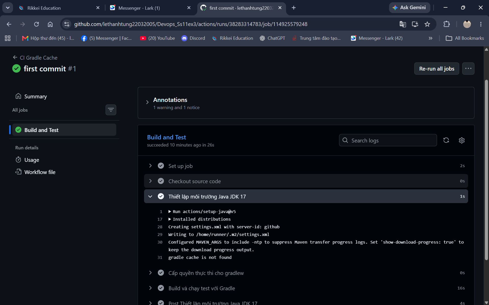
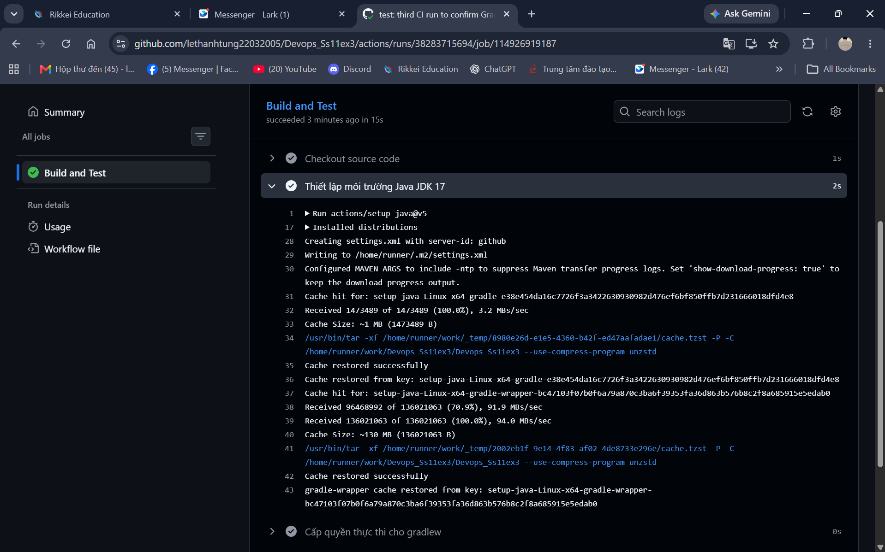

# Báo cáo: Tối ưu tốc độ CI bằng Gradle Dependency Caching

## 1. Mục tiêu

Bật caching cho Gradle dependencies trong GitHub Actions để không phải tải lại
toàn bộ thư viện từ Internet ở mỗi lần chạy CI.

## 2. Thay đổi thực hiện

Bổ sung `cache: 'gradle'` vào bước `actions/setup-java@v5` trong
`.github/workflows/ci.yml`:

```yaml
- name: Thiết lập môi trường Java JDK 17
  uses: actions/setup-java@v5
  with:
    java-version: '17'
    distribution: 'temurin'
    cache: 'gradle'
```

Khi bật tùy chọn này, action sẽ:
- Tự động băm (hash) các tệp `**/*.gradle*` và `**/gradle-wrapper.properties`
  để tạo cache key dạng `gradle-<hash>`.
- Lưu thư mục `~/.gradle/caches` và `~/.gradle/wrapper` vào GitHub Actions Cache.
- Ở các lần chạy sau, nếu cache key trùng thì khôi phục lại cache thay vì tải mới.

## 3. Kết quả đo thời gian (lấy từ tab Actions)

Thời gian đo trực tiếp từ log các lần chạy:

| Lần chạy | Trạng thái cache | Bước `setup-java` | Bước `./gradlew test` | Tổng thời gian Job |
|----------|------------------|-------------------|------------------------|--------------------|
| Run #1 – push đầu | Cache miss | ~1s | ~16s | 26s (tổng run 29s) |
| Run #2 – push ngay sau | Cache miss (chạy song song run #1 nên chưa kịp lưu cache) | ~1s | ~17s | 23s (tổng run 25s) |
| Run #3 – push sau khi cache đã lưu | **Cache hit** | ~2s (gồm khôi phục cache) | ~7s | 15s (tổng run 18s) |

Chênh lệch rõ nhất ở bước `./gradlew test`: **~16s → ~7s** (giảm hơn 50%) và
tổng thời gian job **26s → 15s**, do không phải tải lại dependencies từ Maven Central.

> Lần push #2 chạy chỉ ~6 giây sau push #1 (cả hai workflow chạy song song), nên
> cache chưa kịp lưu → vẫn cache miss. Push #3 chạy sau khi cache đã lưu nên đạt cache hit.

## 4. Kiểm tra log lần push có cache

Trích log thực tế bước `setup-java` ở run #3 (cache hit):

```
Cache hit for: setup-java-Linux-x64-gradle-e38e454da16c7726f3a3422630930982d476ef6bf850ffb7d231666018dfd4e8
Received 1473489 of 1473489 (100.0%), 3.2 MBs/sec
Cache Size: ~1 MB (1473489 B)
Cache restored successfully
Cache restored from key: setup-java-Linux-x64-gradle-e38e454da16c7726f3a3422630930982d476ef6bf850ffb7d231666018dfd4e8

Cache hit for: setup-java-Linux-x64-gradle-wrapper-bc47103fbbf0a79870c3ba6f39353fa36d863b5768bc2f8a685915e5edab0
Received 136021063 of 136021063 (100.0%), 94.0 MBs/sec
Cache Size: ~130 MB (136021063 B)
Cache restored successfully
gradle-wrapper cache restored from key: setup-java-Linux-x64-gradle-wrapper-bc47103fbbf0a79870c3ba6f39353fa36d863b5768bc2f8a685915e5edab0
```

Hai gói cache được khôi phục:
- `setup-java-Linux-x64-gradle-<hash>` (~1 MB): cache dependencies/build của Gradle.
- `setup-java-Linux-x64-gradle-wrapper-<hash>` (~130 MB): wrapper Gradle đầy đủ.

Nếu là lần đầu tiên (cache miss), log sẽ hiển thị `gradle cache is not found`
(kèm `Cache not found for input keys: ...`) và cuối Job sẽ có bước
`Post Thiết lập môi trường Java JDK 17` để lưu cache mới:

```
gradle cache is not found
```

## 5. Ảnh chụp màn hình minh chứng

**Run #1 – cache miss (`gradle cache is not found`, job 26s):**



**Run #3 – cache hit (`Cache restored successfully`, job 15s):**



## 6. Kết luận

- Sau khi cache được lưu, các lần push tiếp theo nhanh hơn rõ rệt: bước
  `./gradlew test` giảm từ ~16s xuống ~7s, tổng thời gian job giảm từ 26s xuống 15s.
- Bước `setup-java` thể hiện việc khôi phục cache thay vì tải mới.
- Bước `./gradlew test` giảm mạnh vì không phải resolve và download thư viện
  (JUnit 5, Gradle plugins...) từ Maven Central.
- Cơ chế cache tự động vô hiệu hóa (invalidate) khi các tệp cấu hình Gradle
  thay đổi, nên vẫn đảm bảo tính đúng đắn của build.
